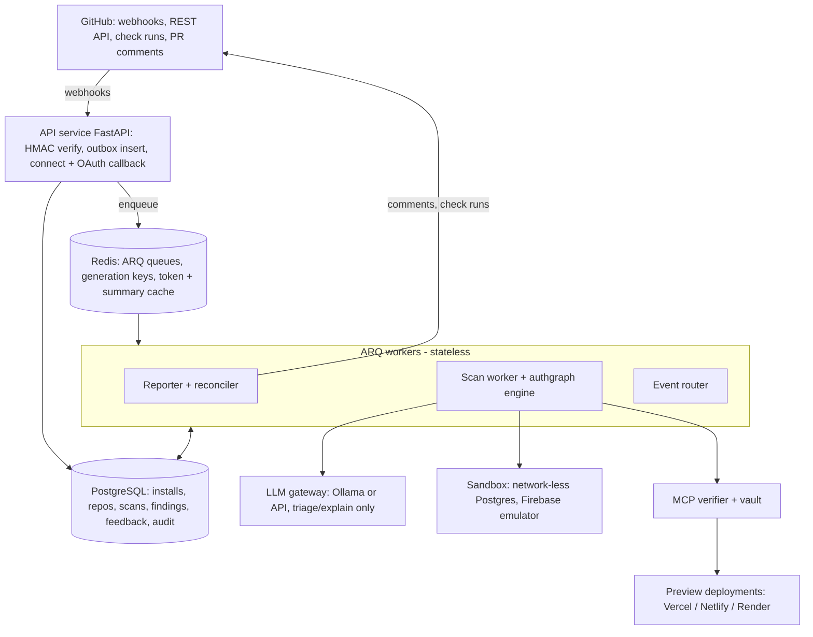

# AccessGuard — Project Plan, HLD and LLD

Oct 23, 2026 · @Anish Gupta

## 1. Project charter

AccessGuard is a GitHub App, installed like CodeRabbit, that answers one question on every PR and every push to main: **who can access what, and did this change make it worse?** It checks that question at three layers (code, database, running app) with one shared engine, and reports only what got worse.

### Problem

AI coding tools have mostly stopped producing SQL injection and XSS, but they still ship broken access control: routes with no auth, missing ownership checks (IDOR), admin actions with no role check, Supabase tables with row-level security off, and service-role keys in browser code. Rule engines miss these (CodeQL and Semgrep found 0 of 30 real access-control advisories in the ABSENTIA study) and unaided LLM agents mostly guess (3 of 30). These bugs caused the Lovable CVE-2025-48757 and Moltbook exposures.

### Target users

| User | What they need from AccessGuard |
| --- | --- |
| Solo founders and vibe-coders (Lovable, Bolt, Cursor, Replit) | A plain-English warning before an AI change exposes user data, with zero setup |
| Small product teams using PRs | A merge gate that blocks access-control regressions without noise |
| Reviewers of AI-generated PRs | Evidence: which guard was removed, where it used to be inherited from |

### Vision

The independent verifier for AI-written backends: the AI that wrote the code is not the one that approves it.

### Goals and success metrics

| Goal | Metric | Target |
| --- | --- | --- |
| Trustworthy findings | Effective false-positive rate per rule (no positive action taken) | Under 10% for every rule shown as a review comment |
| Catch regressions | Recall on synthetic PR mutations (removed guard, middleware reorder, dropped owner filter) | 95% or more |
| Complete route map | Route recall vs sandboxed runtime route list on benchmark repos | 95% or more, UNKNOWN rate reported |
| Fast feedback | p95 time from webhook to posted review | Under 2 minutes |
| Reliable delivery | Webhooks lost after reconciliation | 0 |
| Real-world proof | Public vibe-coded repos scanned in the pilot | 30 to 50, with a published per-rule precision table |

### In scope

- **Code layer:** FastAPI (first) and Express route discovery, authentication, role and ownership checks, and base-vs-head regressions.
- **Data layer:** Supabase migrations (RLS, policies, grants) and Firebase security rules; service-role and secret keys reaching client code.
- **Runtime layer:** optional proof of findings against PR preview deployments through a credential-isolated MCP broker.
- **Delivery:** GitHub App (PR review comments, check runs) and a CLI for local and CI use.

### Non-goals (deliberately cut to keep one theme)

- No web frontend or dashboard. GitHub (check runs, PR comments) and the CLI are the interface; configuration lives in `.accessguard.yml`.
- No rate-limiting detection (infrastructure-level, noisy, not access control).
- No supply-chain checks (hallucinated packages) or general code-quality smells (swallowed errors, test tampering), except a swallowed or weakened auth check, which FR-3.5 already covers.
- No style or general review comments. CodeRabbit already does that.
- No execution of PR code outside disposable, network-less sandboxes.

## 2. Feature catalogue

The product is four components around one engine, and every feature produces or consumes the same access facts. Confidence tier decides how a finding is shown: **Deterministic** findings post as inline review comments and can fail the check; **Heuristic** findings post only when their score is high; **Advisory** findings go in the check-run summary only, until runtime verification upgrades them to Verified.

### Component A: `authgraph` engine (library + CLI)

| ID | Feature | How it works (one line) | Tier | Phase |
| --- | --- | --- | --- | --- |
| FR-3.1 | Route discovery, FastAPI | Static router graph: decorators, `add_api_route`, `include_router` prefixes, `mount`, cross-file imports; dynamic parts marked `<dynamic>` | Deterministic | 1 |
| FR-3.2 | Missing authentication, FastAPI | Effective guard set = app + router + include + decorator + parameter `Depends`, expanded transitively; verdict AUTH / NO\_AUTH / UNKNOWN | Deterministic | 1 |
| FR-7.6 | Custom guard learning | Feature scoring (raises 401/403, `jwt.decode`, reads Authorization) then LLM for ambiguous cases, confirmed by maintainers into config | Heuristic to Deterministic | 1 (rules), 3 (LLM) |
| FR-3.5 | Removed or weakened checks | Same facts on base and head, diffed: guard removed, condition weakened (Z3), check moved after sink, `raise` neutered, owner filter dropped | Deterministic | 1 |
| FR-3.6 | Cross-file context | Per-file summaries cached by git blob SHA, own import resolver, re-summarize only changed files | Engineering | 1 |
| FR-3.1/3.2 | Express support | Router mount tree with source-order middleware; guard = auth middleware registered before the route on an ancestor | Deterministic | 3 |
| FR-3.4 | Admin action without role check | Sensitivity labels + peer-group consistency (Engler z-score, 9 of 10 siblings use `require_admin`), absolute fallback rule | Heuristic | 3 |
| FR-3.3 | IDOR / BOLA | ID param traced to ORM sink; high tier = no principal at all; medium tier = LLM judges whether the check covers the same object | Heuristic | 3 (high tier), 4 (verified) |
| FR-3.7 | Role checked only in the frontend | Link `fetch`/`axios` URLs and Next.js server actions to backend routes; flag UI role gate with no backend role atom | Heuristic | Stretch |
| CLI | `authgraph scan`, `authgraph diff base..head` | JSON and SARIF output; usable in any CI without the GitHub App | n/a | 1 |

### Component B: data-layer analyzer (engine plug-in)

| ID | Feature | How it works | Tier | Phase |
| --- | --- | --- | --- | --- |
| FR-3.8 | Supabase RLS and grants | Apply migrations to a disposable network-less `supabase/postgres`, run splinter-style catalog checks on base and head, report new keys; custom checks for NULL fail-open policies | Deterministic | 3 |
| FR-3.8b | Supabase proof probes | `SET ROLE anon`, then attempt SELECT and INSERT on exposed tables in the same sandbox | Verified | 4 |
| FR-3.9 | Firebase rules | Own parser for `firestore.rules`, `storage.rules`, `database.rules.json`; literal-open and auth-only rules | Deterministic / Heuristic | 3 |
| FR-3.10 | Service-role keys in client code | Decode JWT `role` claim, `sb_secret_` prefix, `NEXT_PUBLIC_`/`VITE_` secret env names, client vs server file classification | Deterministic | 3 |

### Component C: GitHub App (delivery only, no analysis logic)

| ID | Feature | How it works | Phase |
| --- | --- | --- | --- |
| FR-1.1 | Connect via Sign in with GitHub | Install + OAuth in one flow, server-side single-use state + PKCE, link only installations listed in `GET /user/installations` | 2 |
| FR-1.2 | Record installations and repos | `installation` / `installation_repositories` webhooks as triggers; full re-list from `GET /installation/repositories` | 2 |
| FR-1.3 | Uninstall, suspend, missed webhooks | State machine per event + reconciler (failed-delivery redelivery every 15 min, state diff hourly) | 2 |
| FR-1.4 | Onboarding | No writes on install; intro section in the first PR review; optional config PR | 2 |
| FR-1.5 | Stack detection | Linguist languages + recursive tree + manifest parsing per directory (monorepo-aware) | 2 |
| FR-1.6 | Baseline scan | Tarball or shallow clone pinned to SHA; low-priority queue with per-installation rate budget | 2 |
| FR-2.1 | PR scans | `opened`, `synchronize`, `reopened`, `ready_for_review`; keyed on live `head.sha`; fork code treated as data only | 2 |
| FR-2.2 | Pushes to main | Compare `before...after`; check run on `after`; dedup issue for high severity | 2 |
| FR-2.3 | Skip drafts | Gate on live `draft` flag, `ready_for_review` triggers, command overrides | 2 |
| FR-2.4 | `@accessguard scan` and Re-run | Commenter needs write permission; bot-loop guard; token-bucket rate limits | 2 |
| FR-2.6 | Cancel outdated scans | Redis generation counter per PR, checked between phases and before posting | 2 |
| REP | Reporter | Inline comments with evidence chain, summary, check run, stable fingerprints, update-not-duplicate, auto-resolve when fixed | 2 |
| FB | Feedback | 👎 / `@accessguard ignore <reason>` / inline `# accessguard-ignore`; per-rule effective-FP tracking with auto-demotion | 2 |

### Component D: runtime verifier (MCP broker)

| ID | Feature | How it works | Phase |
| --- | --- | --- | --- |
| FR-2.5 | Preview deployment trigger | `deployment_status` / `status` events, map SHA to PR, host allowlist + SSRF guard, Vercel bypass header | 4 |
| RV-1 | Credential vault | Per-repo test accounts encrypted (envelope encryption); never returned to any caller | 4 |
| RV-2 | MCP tool generation | Tools generated from engine route facts by templates (never written by the LLM): `call_as(user, method, path, params)` | 4 |
| RV-3 | Verification plans | LLM proposes the test sequence (create as A, read as B); broker executes; deterministic response comparison decides | 4 |
| RV-4 | Safety policy | Preview hosts only, reads by default, writes only to bot-created data, call budget, redaction, full audit log | 4 |

## 3. Roadmap

Five phases over 16 weeks (assuming one developer at about 20 hours a week), each ending in a measurable gate, and each shipping something usable on its own: the CLI after Phase 1, the GitHub App after Phase 2.

| Phase | Weeks | Builds | Gate |
| --- | --- | --- | --- |
| 0. Foundations | 1-2 | Repo, CI, ADRs, dev/prod GitHub Apps, eval corpus skeleton | Corpus runs in CI, ADR 001-008 written |
| 1. Engine core (FastAPI) | 3-7 | Router graph, guard closure, guard scoring, base-vs-head diff, CLI (JSON/SARIF) | Route recall >=95%, mutation recall >=95%, precision >=90% |
| 2. GitHub App delivery | 8-10 | Webhooks, outbox, reconciler, install linking, PR/push scans, reporter, feedback, cancellation | E2E on staging, p95 < 2 min, zero lost webhooks |
| 3. Breadth and data layer | 11-13 | Express, role consistency, IDOR high tier, LLM judge, Supabase RLS, Firebase rules, client secrets | Every rule measured, none >10% effective FP |
| 4. Runtime verification | 14-16 | Preview trigger, MCP broker, vault, two-user replay, probes, pilot on 30-50 repos | v1.0 with published precision table |

Phase 1 is the critical path: nothing after it is worth building until the engine passes its precision gate.

### Phase 0: Foundations (weeks 1 to 2)

**Builds:** everything in the initiation checklist (Section 4), eval corpus layers 1 to 3 as empty-but-runnable harness, dev and prod GitHub App registrations.

**How:**

1. Create the `uv` monorepo, tooling, pre-commit and the CI workflow.
2. Write ADR 001 to 008.
3. Collect 10 seed FastAPI repos and VAmPI; write the sandbox script that dumps `app.routes` as ground truth.
4. Write the first 10 synthetic mutation cases (positive and negative) as fixtures, with expected findings in YAML.

**Exit:** `make eval` runs in CI and reports per-rule numbers (all zero for now).

### Phase 1: Engine core, FastAPI (weeks 3 to 7)

**Builds:** FR-3.1, FR-3.2, FR-3.5, FR-3.6, FR-7.6 (scoring + config, no LLM yet), CLI, rules AG-AUTH-001/002/003, AG-ROLE-002, AG-CFG-001.

**How:**

1. Week 3: fact model (6.2), `SourceTree`, Python summarizer, summary cache by blob SHA.
2. Week 4: Python import resolver and FastAPI router graph; enumerate routes and compare against sandbox `app.routes`.
3. Week 5: dependency closure, built-in guard seeds, guard feature scoring, `.accessguard.yml` loader; three-valued verdicts.
4. Week 6: diff stage: endpoint matching, deltas, Z3 weakened-condition check.
5. Week 7: rules, fingerprints, `authgraph scan` / `authgraph diff` with JSON and SARIF, eval report.

**Exit gate:** route recall 95% or more on the seed repos, mutation recall 95% or more, deterministic-rule precision 90% or more, pure moves produce zero findings.

### Phase 2: GitHub App delivery (weeks 8 to 10)

**Builds:** FR-1.1 to FR-1.6, FR-2.1 to FR-2.4, FR-2.6, reporter, feedback loop.

**How:**

1. Week 8: webhook intake with HMAC (GitHub test vector), delivery table as outbox, ARQ workers, `route_delivery`.
2. Week 9: install linking (state + PKCE + `/user/installations`), installation and repo state machine, reconciler crons, stack detection, rate-budgeted baseline scans.
3. Week 10: `scan_pr` and `scan_push`, generation-based cancellation, draft gate, `@accessguard` commands, reporter (check runs, inline comments upserted by fingerprint), feedback and `rule_stats`; deploy staging and dogfood on the AccessGuard repo.

**Exit gate:** scripted end-to-end PRs on staging produce exact expected comments; p95 scan under 2 minutes; killing the server for 10 minutes loses no webhooks after reconciliation.

### Phase 3: Breadth and data layer (weeks 11 to 13)

**Builds:** Express support (FR-3.1/3.2), FR-3.4, FR-3.3 high tier, LLM judge (guard classification, triage, explanations), FR-3.8, FR-3.9, FR-3.10.

**How:**

1. Week 11: tree-sitter JS/TS summarizer, Node module resolver, Express mount tree and middleware order; Juice Shop as ground truth.
2. Week 12: sandbox image; Supabase migration replay with catalog checks on base and head; Firebase rules parser; secret detectors with client/server classifier.
3. Week 13: role-consistency ranking, IDOR candidate generator, LLM judge through LiteLLM with JSON schemas; measure triage true-positive retention.

**Exit gate:** every rule has a measured precision; none shown inline above 10% effective FP; triage keeps 96% or more of true positives.

### Phase 4: Runtime verification and pilot (weeks 14 to 16)

**Builds:** FR-2.5, RV-1 to RV-4, FR-3.8b Supabase probes, IDOR verified tier.

**How:**

1. Week 14: preview-deployment ingestion, SHA-to-PR mapping, host allowlist and SSRF guard, Vercel bypass header.
2. Week 15: MCP broker: tool generation from facts, vault, policy engine, redaction, audit log; `SET ROLE anon` probes.
3. Week 16: pilot on 30 to 50 public vibe-coded repos, hand-label findings, publish the per-rule precision table and a write-up; fix the top false-positive sources.

**Exit gate:** v1.0 tagged; README shows measured precision per rule and pilot results.

**After v1.0 (stretch):** FR-3.7 frontend-only role checks, Next.js server actions, Django and NestJS adapters.

## 4. Project initiation

Set up the project the way a company would on day one: one monorepo, written decisions, a CI gate that measures precision, and a risk register, before any feature code.

### Initiation checklist (Phase 0)

- [ ] Write this charter and feature catalogue into `docs/` (PRD)
- [ ] Create the monorepo, licence (Apache-2.0), `CONTRIBUTING.md`, `SECURITY.md`, code of conduct
- [ ] Register two GitHub Apps: `accessguard-dev` (smee.io webhook) and `accessguard` (production)
- [ ] Record the first ADRs (list below)
- [ ] Set up tooling, pre-commit and CI
- [ ] Build the evaluation corpus skeleton (Section 7) before writing the engine
- [ ] Create a GitHub Project board with one milestone per phase
- [ ] Write the privacy policy: code is fetched per scan, never stored after the scan

### Tooling and conventions

| Area | Choice |
| --- | --- |
| Language / runtime | Python 3.12 |
| Packaging | `uv` workspaces (one lockfile for all packages) |
| Lint / format / types | `ruff`, `ruff format`, `mypy --strict` on `authgraph` |
| Tests | `pytest`, `pytest-asyncio`, `hypothesis` for resolver edge cases, `testcontainers` for Postgres/Redis |
| Parsing | Python `ast` for Python, `tree-sitter` (+ `tree-sitter-javascript`, `tree-sitter-typescript`) for JS/TS |
| Web / GitHub | FastAPI, `githubkit`, `httpx` |
| Queue | ARQ on Redis |
| Database | PostgreSQL 16, SQLAlchemy 2 (async), Alembic migrations |
| LLM | LiteLLM gateway: Ollama local model or a cloud API, selected by config |
| Constraint solving | `z3-solver` (weakened-condition check) |
| SQL parsing | `pglast` (offline Supabase fallback) |
| Branching | Trunk-based: short-lived feature branches, squash merge, protected `main` |
| Commits | Conventional Commits (`feat:`, `fix:`, `docs:`), semantic-release tags for the CLI |
| Issues | GitHub Projects; every issue tagged with its FR ID and phase milestone |

### CI/CD pipeline (GitHub Actions)

1. **On every PR:** ruff, mypy, unit tests, resolver property tests.
2. **Eval gate:** run the labelled corpus (Section 7); fail the PR if any rule's precision or recall drops versus `main`.
3. **Dogfooding:** AccessGuard reviews its own repository.
4. **On merge to main:** build Docker images (`api`, `worker`, `sandbox`), push to GHCR, deploy to staging.
5. **On tag:** publish the `authgraph` CLI to PyPI, promote images to production.

### Environments

| Environment | Purpose | Setup |
| --- | --- | --- |
| Local | Development | `docker compose`: api, worker, Postgres, Redis, Ollama; webhooks through smee.io to the dev app |
| Staging | End-to-end tests on owned test repos | Fly.io or Render, separate GitHub App, separate database |
| Production | Real installs | Same images, secrets from the platform secret store, app private key never in the repo |

### Architecture decision records to write first

| ADR | Decision | Reason |
| --- | --- | --- |
| 001 | Own analysis engine on `ast` + tree-sitter | CodeQL CLI licence forbids private non-OSS codebases; Semgrep CE is single-file; Semgrep rules cannot be offered as a service |
| 002 | Deterministic engine is the only source of findings | Unaided LLM agents: 82 to 86% false positives, non-repeatable |
| 003 | Report only diff-introduced findings | Facebook Infer: over 70% fixed at diff time vs near zero as batch reports |
| 004 | ARQ over Celery | asyncio-native, `_job_id` dedup, safe cooperative abort |
| 005 | Never execute PR code outside a disposable network-less sandbox | Fork PRs are untrusted; GitHub Security Lab "pwn request" guidance |
| 006 | Config read from the base branch only | A PR must not be able to declare its own guards or public routes |
| 007 | No frontend; GitHub UI + CLI + config file | Keeps scope on the engine; check runs and comments already give the interface |
| 008 | MCP tools generated from facts, never written by an LLM | Prompt injection in repo content could otherwise exfiltrate credentials |

### Risk register

| Risk | Likelihood | Impact | Mitigation |
| --- | --- | --- | --- |
| False positives make users uninstall | High | High | Diff-only, three-valued verdicts, per-rule FP tracking, auto-demote rules above 10% |
| Router resolution misses dynamic patterns | Medium | High | UNKNOWN verdict instead of guessing; measure against sandboxed runtime route lists |
| Custom auth helpers misclassified | High | High | FR-7.6 guard learning + maintainer confirmation; unconfirmed guards only produce "possible" notes |
| Prompt injection through repo text | Medium | Medium | LLM is tool-less and may only downgrade with a logged reason |
| GitHub rate limits during org-wide installs | Medium | Medium | Per-installation token buckets, low-priority baseline queue, jitter |
| Sandbox escape when applying migrations | Low | High | Disposable container, no network, no secrets, resource limits |
| Scope creep into general code review | Medium | Medium | One-question rule: features that don't answer "who can access what" are cut |
| Solo developer time | High | Medium | Each phase ships something usable on its own; Phase 4 is optional |

### Definition of done (every feature)

- Unit tests plus at least one positive and one negative case in the eval corpus
- Precision and recall for its rule recorded in the eval report, no regression
- Every finding carries an evidence chain and a stable fingerprint
- Structured logs and metrics emitted; failure modes documented
- ADR written if it changes architecture

## 5. High-level design

AccessGuard is an event-driven system with one rule: **all analysis happens in workers through the `authgraph` engine**, while the API only accepts events and GitHub only receives results. There is no frontend; GitHub check runs and PR comments are the user interface.



Webhooks land in the API, which stores them in Postgres (as an outbox) and enqueues work in Redis; workers run the engine, call the LLM, sandbox and verifier as needed, and the reporter writes results back to GitHub.

### Components

| Component | Responsibility | Scales by | State |
| --- | --- | --- | --- |
| API service | Webhook intake (verify, store, enqueue, 202 in under 10 s), install linking, health and metrics | Replicas behind a load balancer | Stateless |
| PostgreSQL | Installations, repos, PR state, scans, findings, feedback, rule stats, verifier audit and credentials (encrypted) | Vertical, read replica later | Durable |
| Redis | ARQ queues (high, low), PR generation counters, token cache, summary cache, rate budgets | Single node, managed | Ephemeral |
| Event router | Turns deliveries into work, re-fetches live PR state, dedups by work key, supersedes old scans | Worker replicas | Stateless |
| Scan worker + `authgraph` | Fetch code, build base and head fact graphs, diff, rules, fingerprints | Worker replicas (CPU-bound) | Stateless (cache in Redis) |
| Reporter and reconciler | Check runs, review comments, issue for main-branch findings; failed-delivery redelivery and state sync crons | Worker replicas | Stateless |
| LLM gateway | Guard classification, finding triage (downgrade only), explanations | Local Ollama or API, per config | Stateless |
| Sandbox | Apply Supabase migrations and run Firebase emulator tests with no network and no secrets | One container per job | Disposable |
| MCP verifier + vault | Runtime proof against preview deployments with credentials the LLM never sees | Separate process, own secrets | Audit log |

### Main data flows

1. **Install:** user opens `/connect` → GitHub install + OAuth → `/callback` verifies the installation in `GET /user/installations` → `installation.created` webhook creates the record → baseline scan queued at low priority.
2. **PR scan:** `pull_request` webhook → API outbox → event router → `scan_pr` (debounced, generation-checked) → engine on base and head → rules → LLM triage → reporter → check run and inline comments on `head.sha`.
3. **Push to main:** `push` webhook → compare `before...after` → engine → check run on `after` and a deduplicated issue for high-severity findings.
4. **Verification (Phase 4):** `deployment_status` success → map SHA to PR → verifier generates tools from the scan's facts → LLM plans test steps → broker executes with vaulted credentials → deterministic comparison marks findings Verified.
5. **Recovery:** reconciler redelivers failed webhooks every 15 minutes and diffs installations and repos hourly.

### Deployment

| Item | Choice |
| --- | --- |
| Images | `api`, `worker`, `sandbox`, `verifier` (Docker, GHCR) |
| Hosting | Fly.io or Render: 1 API instance, 2 workers to start; managed Postgres and Redis |
| LLM | Ollama on a GPU host for the private tier, or an API key; off by default in the CLI |
| Secrets | GitHub App private key, webhook secret, vault master key in the platform secret store |
| Domains | `api.<domain>` for webhooks and callback only |

### Scaling plan

- Workers are stateless; scale on queue depth. PR jobs never wait behind baselines (separate queues).
- Blob-SHA summary cache makes repeat scans cost only changed files; target about 30 s typical PR scan.
- Per-installation GitHub rate budgets and concurrency caps (2 to 4) stop one large org from starving others.
- Postgres growth is bounded: no source code stored, findings keyed by fingerprint, old scans archived after 90 days.

### Security model

| Threat | Control |
| --- | --- |
| Forged webhooks | HMAC-SHA256 on raw body, constant-time compare |
| Installation hijack via spoofed `installation_id` | Link only installations returned by `GET /user/installations` for the authenticated user; single-use state + PKCE |
| Malicious PR code | Never executed; migrations and emulator tests only in disposable network-less sandbox |
| PR edits its own config to allowlist itself | Config read from base branch; config changes reported as findings (AG-CFG-001) |
| Prompt injection in repo text | LLM is tool-less, gets no secrets, may only downgrade with logged reason |
| SSRF via forged deployment URLs | Host allowlist, DNS resolution with private-IP block, creator check |
| Credential leakage in verification | Vault with envelope encryption, redaction, tools generated from templates only |
| Excess GitHub permissions | Contents read, Pull requests write, Checks write, Issues write, Metadata read; nothing else |
| Customer code retention | Code held only for the scan; summaries keyed by blob SHA expire in 30 days |

### Non-functional requirements

| Requirement | Target |
| --- | --- |
| Webhook acknowledgement | Under 10 s always (target under 300 ms) |
| PR scan latency | p95 under 2 minutes |
| Availability | No lost events: outbox + reconciler guarantee eventual processing |
| Idempotency | Every job safe to run twice (delivery GUID + work key) |
| Precision | Under 10% effective false positives per inline rule |
| Privacy | No stored source code; local-LLM option |

## 6. Low-level design

The LLD is built around one data contract, the **access fact model**: every analyzer writes it, every rule reads it, and the GitHub App and MCP broker never look at source code directly.

### 6.1 Repository layout

```
accessguard/
├── packages/
│   ├── authgraph/                 # Component A: engine (pure library, no I/O to GitHub)
│   │   ├── facts/                 # Pydantic fact model (6.2), fingerprints
│   │   ├── workspace/             # SourceTree abstraction: dir, tarball, git objects
│   │   ├── lang/python/           # ast summarizer, import resolver
│   │   ├── lang/javascript/       # tree-sitter summarizer, Node module resolver
│   │   ├── frameworks/fastapi.py  # router graph + dependency closure
│   │   ├── frameworks/express.py  # mount tree + middleware order
│   │   ├── guards/                # guard feature scoring, registry, config loader
│   │   ├── data/supabase/         # migration replay, catalog checks, probes
│   │   ├── data/firebase/         # rules parser
│   │   ├── secrets/               # JWT role decoder, client/server classifier
│   │   ├── rules/                 # one module per rule (6.5)
│   │   ├── diff/                  # base-vs-head fact diff, route matching, Z3
│   │   ├── llm/                   # judge interface, prompts, schemas (tool-less)
│   │   ├── cache/                 # summary cache keyed by blob SHA
│   │   └── cli.py                 # authgraph scan | diff | explain
│   ├── app/                       # Component C: GitHub App
│   │   ├── api/                   # FastAPI: /webhooks/github, /connect, /callback, /healthz
│   │   ├── github/                # githubkit client, token cache, rate budget
│   │   ├── domain/                # installations, repos, scans, findings services
│   │   ├── jobs/                  # ARQ job functions (6.8)
│   │   ├── reporter/              # check runs, review comments, summaries
│   │   ├── reconciler/            # delivery recovery, state sync (cron)
│   │   └── db/                    # SQLAlchemy models, Alembic
│   ├── sandbox/                   # Docker image: network-less Postgres + emulator runner
│   └── verifier/                  # Component D: MCP broker, vault, policy
├── eval/                          # corpus, synthetic mutations, harness, reports
├── docs/                          # PRD, ADRs, runbooks
└── deploy/                        # docker-compose, fly.toml, migrations
```

Dependency rule: `app` and `verifier` import `authgraph`; `authgraph` imports nothing from them.

### 6.2 Access fact model (the shared contract)

```python
class Verdict(StrEnum):  AUTH = "auth"; NO_AUTH = "no_auth"; UNKNOWN = "unknown"
class GuardKind(StrEnum): AUTHN = "authn"; OPTIONAL_AUTHN = "optional_authn"; AUTHZ_ROLE = "authz_role"; AUTHZ_OWNER = "authz_owner"; FAKE = "fake"

class Loc(BaseModel):            path: str; line: int; col: int; blob_sha: str

class GuardRef(BaseModel):
    symbol: str                   # "app.deps.get_current_user"
    kind: GuardKind
    source: Literal["builtin", "config", "scored", "llm"]
    confidence: float
    inherited_from: Loc | None    # include_router / app.use that applied it
    dominates_sink: bool | None   # runs before the first sensitive sink
    on_fail: Literal["raise", "return_4xx", "log_only", "none", "unknown"]

class Sink(BaseModel):
    kind: Literal["read", "write", "delete"]
    orm: str                      # "sqlalchemy.session.get", "prisma.findUnique"
    model: str | None
    id_param: str | None          # request param that reaches this sink
    principal_scoped: bool        # predicate includes current user / tenant
    loc: Loc

class Endpoint(BaseModel):
    id: str                       # stable: f"{method} {normalized_path}"
    method: str; path: str        # path may contain <dynamic>
    framework: Literal["fastapi", "express", "nextjs"]
    handler: str; loc: Loc
    guards: list[GuardRef]
    authn: Verdict
    sensitivity: set[str]         # {"delete", "admin_path", "role_write", "mass_assign"}
    sinks: list[Sink]
    public_by_config: bool

class DataExposure(BaseModel):    # Supabase / Firebase
    resource: str                 # "public.messages", "firestore:/users/{uid}"
    role: str                     # "anon", "authenticated", "any"
    ops: set[str]                 # {"select", "insert"}
    reason: str                   # "rls_disabled", "using_true", "null_fail_open"
    proven: bool; loc: Loc

class SecretExposure(BaseModel):  kind: str; client_side: bool; loc: Loc

class FactGraph(BaseModel):
    commit_sha: str
    endpoints: list[Endpoint]
    data_exposures: list[DataExposure]
    secrets: list[SecretExposure]
    guard_registry: list[GuardRef]
    coverage: Coverage            # files parsed, UNKNOWN count, unresolved imports

class Finding(BaseModel):
    rule_id: str                  # "AG-AUTH-002"
    fingerprint: str              # 6.6
    severity: Literal["critical", "high", "medium", "low"]
    tier: Literal["deterministic", "heuristic", "advisory", "verified"]
    title: str; endpoint_id: str | None; loc: Loc
    evidence: list[EvidenceStep]  # ordered chain shown in the comment
    explanation: str | None; suggested_fix: str | None
    llm_triage: TriageResult | None
```

### 6.3 Engine pipeline (per commit)

1. **Load** a `SourceTree` for the commit (files + blob SHAs; no execution).
2. **Summarize** each file: cache hit by blob SHA, else parse with `ast` / tree-sitter into a `FileSummary` (imports, exports, app/router constructions, route registrations with source order, include/use/mount edges, dependency refs, guard features, ID sources, ORM sinks).
3. **Resolve** imports into a module graph (own Python package-root and Node resolution: relative paths, `index.js`, `package.json` `exports`/`main`, tsconfig `paths`).
4. **Build** framework graphs: FastAPI router graph, Express mount tree.
5. **Score guards** (FR-7.6) and merge with the confirmed registry from base-branch config.
6. **Compute** each endpoint's effective guard set, sinks and verdict.
7. **Run** data-layer and secret analyzers.
8. **Emit** `FactGraph`.

A PR scan runs this twice (base, head; most summaries are cache hits) and passes both graphs to the diff stage and rules.

### 6.4 Core algorithms

**FastAPI route enumeration and guard closure**

```python
def enumerate_routes(app: RouterNode) -> list[Endpoint]:
    out = []
    def walk(node, prefix, inherited_deps, chain):
        deps = inherited_deps + node.constructor_deps        # APIRouter(dependencies=)
        for r in node.routes:                                # decorators + add_api_route
            all_deps = deps + r.decorator_deps + r.param_deps  # Depends / Security / Annotated
            out.append(make_endpoint(r, join(prefix, node.prefix, r.path), all_deps, chain))
        for inc in node.includes:                            # include_router(child, prefix, dependencies)
            walk(inc.child, join(prefix, node.prefix, inc.prefix), deps + inc.deps, chain + [inc.loc])
        for m in node.mounts:                                # mounted sub-apps do NOT inherit deps
            walk(m.app, join(prefix, m.path), [], chain + [m.loc])
    walk(app, "", app.app_deps, [])
    return out

def verdict(deps) -> Verdict:
    closure = transitive_closure(deps)                       # deps of deps, depth-limited, cycle-safe
    kinds = {g.kind for g in closure if g.confidence >= CONFIRMED}
    if kinds & {AUTHN, AUTHZ_ROLE, AUTHZ_OWNER}: return AUTH
    if any(unresolved(d) for d in closure): return UNKNOWN
    return NO_AUTH                                          # FAKE / OPTIONAL count as no auth
```

Every root-to-leaf include path produces its own endpoint, because one router can be included twice with different prefixes and dependencies.

**Express guard chain:** for each route registration R, collect middleware M where M is registered on R's router or an ancestor, M's source-order index is lower than R's at the fork point, M's path prefix matches, and M's method matches; then add per-route middleware listed before the final handler. Middleware registered after R, or exempted via `unless({path})` or an allowlist branch, does not guard R.

**Diff stage (FR-3.5):** match endpoints across base and head by `id`, falling back to handler identity for renames. For each matched pair compute deltas:

| Delta | Detection |
| --- | --- |
| `guard_removed` | guard in base set, absent in head set |
| `guard_reordered` | Express auth middleware moved after the route |
| `condition_weakened` | guard predicate as boolean formula; Z3 proves head ⇒ base is false while base ⇒ head holds |
| `sink_before_check` | `dominates_sink` true in base, false in head |
| `failure_neutered` | `on_fail` went from raise/return\_4xx to log\_only/none |
| `scope_removed` | `principal_scoped` true in base, false in head |
| `new_unguarded` | endpoint new in head with NO\_AUTH while its peer group is AUTH |
| `config_widened` | PR edits `public_routes` or `auth_guards` in `.accessguard.yml` |

**IDOR candidates (FR-3.3):** trace ID-like request params through a call graph of depth 4 to ORM sinks. High tier: sink reached and no principal symbol anywhere in handler or callees. Medium tier: principal present but not in the sink predicate and no post-fetch comparison; sent to the LLM judge with a bounded context pack.

**Consistency (FR-3.4):** group endpoints by router prefix + verb class + sensitivity; for each role atom compute z = (e/n − p₀) / √(p₀(1 − p₀)/n) with p₀ = 0.9, n ≥ 4; flag endpoints in groups where z is high and they lack the atom.

### 6.5 Rule interface and initial rules

```python
class Rule(Protocol):
    id: str; title: str; default_severity: str; tier: str
    def evaluate(self, head: FactGraph, base: FactGraph | None, ctx: RuleContext) -> Iterable[Finding]: ...
```

| Rule ID | Fires when | Tier |
| --- | --- | --- |
| AG-AUTH-001 | New or changed endpoint is NO\_AUTH, not public by config | Deterministic |
| AG-AUTH-002 | Guard removed, reordered, weakened or neutered (FR-3.5) | Deterministic |
| AG-AUTH-003 | Mounted sub-app or Express route registered before auth middleware | Deterministic |
| AG-ROLE-001 | Sensitive endpoint lacks role atom that its peers have | Heuristic |
| AG-ROLE-002 | Mass assignment of role/owner fields from request body | Deterministic |
| AG-IDOR-001 | ID reaches sink with no principal at all | Heuristic (high) |
| AG-IDOR-002 | Principal not tied to fetched object (LLM-judged) | Advisory |
| AG-DATA-001 | Supabase table exposed: RLS off, `USING (true)` write, anon grant, view without `security_invoker` | Deterministic |
| AG-DATA-002 | Supabase NULL fail-open policy | Heuristic |
| AG-DATA-003 | Firebase literal-open rule | Deterministic |
| AG-SECRET-001 | Service-role / secret key or secret env name reaches client code | Deterministic |
| AG-CFG-001 | PR widens `public_routes` or `auth_guards` | Deterministic |

### 6.6 Fingerprints and dedup

`fingerprint = sha256(rule_id | repo_id | endpoint_id or resource | normalized delta facts)`. Line numbers are excluded so moved code never resurfaces as new. The reporter stores `fingerprint → comment_id`; a re-scan updates the existing comment, and a fingerprint missing from the new head marks the finding `resolved` and its thread resolved.

### 6.7 Database schema (PostgreSQL)

```sql
create table installations (
  installation_id bigint primary key, account_id bigint not null, account_login text,
  account_type text, repository_selection text, permissions jsonb,
  suspended_at timestamptz, deleted_at timestamptz, last_reconciled_at timestamptz,
  created_at timestamptz default now());

create table users (user_id bigint primary key, login text, created_at timestamptz default now());
create table installation_members (user_id bigint references users, installation_id bigint references installations,
  verified_at timestamptz not null, primary key (user_id, installation_id));
create table oauth_states (state text primary key, pkce_verifier text not null, purpose text,
  user_id bigint, expires_at timestamptz not null);

create table repositories (
  repo_id bigint primary key, installation_id bigint references installations, full_name text,
  default_branch text, private boolean, archived boolean, fork boolean,
  status text not null default 'active',          -- active | paused | removed
  detected_stack jsonb, last_baseline_sha text, config_sha text);

create table webhook_deliveries (
  delivery_guid uuid primary key, event text, action text, installation_id bigint,
  received_at timestamptz default now(), status text not null default 'received', payload jsonb);

create table pr_state (repo_id bigint, pr_number int, head_sha text, generation bigint, draft boolean,
  state text, primary key (repo_id, pr_number));

create table scans (
  scan_id uuid primary key, repo_id bigint references repositories, pr_number int,
  trigger text, base_sha text, head_sha text not null, config_hash text, generation bigint,
  status text not null,                           -- queued | running | done | superseded | failed
  check_run_id bigint, coverage jsonb, timings jsonb,
  started_at timestamptz, finished_at timestamptz,
  unique (repo_id, head_sha, trigger, config_hash));
create unique index one_active_scan_per_pr on scans (repo_id, pr_number) where status in ('queued','running');

create table findings (
  finding_id uuid primary key, scan_id uuid references scans, repo_id bigint, fingerprint text not null,
  rule_id text, severity text, tier text, status text not null,   -- open | resolved | dismissed | suppressed_llm
  endpoint_id text, path text, line int, evidence jsonb, llm_triage jsonb,
  comment_id bigint, first_seen_sha text, last_seen_sha text);
create index on findings (repo_id, fingerprint);

create table feedback (fingerprint text, repo_id bigint, actor_id bigint, kind text,  -- not_useful | fixed | ignored
  reason text, created_at timestamptz default now());
create table rule_stats (rule_id text, period date, shown int, acted int, not_useful int, primary key (rule_id, period));

create table verifier_credentials (repo_id bigint, label text, ciphertext bytea, wrapped_dek bytea,
  created_at timestamptz default now(), primary key (repo_id, label));
create table verifier_audit (id bigserial primary key, scan_id uuid, tool text, method text, url text,
  status int, decision text, created_at timestamptz default now());
```

No source code is stored. Summaries live in the cache only (6.9) and are keyed by blob SHA.

### 6.8 Queues and jobs (ARQ)

| Job | Queue | Idempotency key | Does |
| --- | --- | --- | --- |
| `route_delivery` | high | `delivery:{guid}` | Decide work from the event, upsert state, enqueue scan jobs |
| `scan_pr` | high | `scan:{repo}:{pr}:{head_sha}` (deferred 15 s) | Fetch, analyze base + head, triage, report; checks generation between phases |
| `scan_push` | high | `push:{repo}:{after}` | Compare `before...after`, analyze, report on commit |
| `baseline_scan` | low | `baseline:{repo}:{sha}` | First scan after install; rate-budgeted per installation |
| `verify_findings` | low | `verify:{scan_id}` | Runtime verification via MCP broker (Phase 4) |
| `reconcile_deliveries` | cron 15 min | n/a | Redeliver failed webhook deliveries |
| `reconcile_state` | cron hourly | n/a | Diff installations and repos vs GitHub |
| `outbox_sweeper` | cron 1 min | n/a | Re-enqueue deliveries stuck in `received` |

### 6.9 Redis keys

| Key | Value | TTL |
| --- | --- | --- |
| `tok:inst:{id}` | installation token | expiry − 5 min |
| `pr:{repo}:{n}:head` / `:gen` | latest head SHA / generation counter | 7 days |
| `sum:{lang}:{blob_sha}:{engine_version}` | serialized `FileSummary` | 30 days |
| `rl:inst:{id}` | remaining GitHub budget | until reset |
| `cmd:pr:{repo}:{n}` / `cmd:user:{id}` | command token buckets | 1 min / 1 h |
| `perm:{repo}:{user}` | collaborator permission | 5 min |

### 6.10 HTTP endpoints (no frontend)

| Method + path | Purpose |
| --- | --- |
| `POST /webhooks/github` | Verify HMAC on raw body, insert delivery (`on conflict do nothing`), enqueue, return 202 within 10 s |
| `GET /connect` | Create single-use state + PKCE, redirect to GitHub install/authorize |
| `GET /callback` | Consume state, exchange code, verify installation in `GET /user/installations`, link, show a plain confirmation page |
| `GET /healthz`, `GET /readyz` | Liveness, readiness (DB + Redis) |
| `GET /metrics` | Prometheus metrics |
| `POST /verifier/credentials` | Phase 4: maintainer uploads test-account credentials (authenticated with GitHub user token, write permission checked) |

### 6.11 Repository config: `.accessguard.yml` (read from base branch)

```yaml
version: 1
fail_on: critical            # critical | high | never
scan_drafts: false
paths:
  exclude: ["tests/**", "scripts/**"]
auth_guards:                 # confirmed custom guards (FR-7.6)
  - symbol: app.deps.get_current_user
    kind: authn
  - symbol: app.deps.require_admin
    kind: authz_role
public_routes:
  - route: "GET /health"
    reason: liveness probe
  - route: "POST /webhooks/stripe"
    reason: signature verified in handler
public_models: ["BlogPost"]  # intentionally public resources (IDOR suppression)
rules:
  AG-ROLE-001: { enabled: true }
  AG-IDOR-002: { enabled: false }
llm:
  provider: ollama           # ollama | api | off
verifier:
  enabled: false
  preview_hosts: ["*.vercel.app"]
```

### 6.12 PR scan sequence

1. GitHub sends `pull_request.synchronize`; API verifies signature, stores delivery, enqueues `route_delivery`, returns 202.
2. `route_delivery` re-fetches the PR (live `head.sha`, `draft`, `state`), increments the generation in Redis, aborts older jobs, enqueues `scan_pr` with a 15-second debounce.
3. `scan_pr` creates a `queued` check run on `head.sha`, loads base-branch config, fetches changed files and their reverse-import dependents (cache misses only).
4. Engine builds base and head `FactGraph`s, runs the diff stage and rules; generation re-checked.
5. Medium-tier and ambiguous findings go to the LLM judge (may only downgrade, with reason); explanations generated.
6. Generation checked once more; reporter upserts comments by fingerprint, resolves fixed ones, completes the check run (failure only if a finding meets `fail_on`).
7. Metrics and `rule_stats` updated; feedback reactions are read on later events.

### 6.13 LLM interface

```python
class Judge(Protocol):
    async def triage(self, finding: Finding, context: ContextPack) -> TriageResult: ...
    async def classify_guard(self, fn: FunctionSlice) -> GuardClassification: ...
    async def explain(self, finding: Finding, context: ContextPack) -> Explanation: ...

class TriageResult(BaseModel):
    decision: Literal["keep", "downgrade", "suppress"]   # never "add" or "upgrade"
    reason: str; evidence_lines: list[Loc]
```

Rules: temperature 0, JSON schema output, no tools, no network, no secrets; repo text wrapped as data and stripped of instructions addressed to reviewers; images and agent-instruction files never sent; 2 to 3 samples with majority vote for IDOR judgments; every suppression logged and counted in the check summary.

### 6.14 Runtime verifier (MCP broker)

- **Tool generation:** from verified-candidate endpoints, templates produce MCP tools such as `call_as(identity: Literal["user_a","user_b","anonymous"], method, path, path_params, body)` and `create_fixture(identity, endpoint, body)`. The LLM cannot add tools.
- **Vault:** credentials encrypted with a per-repo data key, wrapped by a master key from the platform secret store; decrypted only inside the broker process at call time.
- **Policy engine (runs before every call):** host on allowlist and DNS not private; method allowed (GET by default; writes only on bot-created fixtures); call budget per scan; response size cap.
- **Redaction:** strip `Authorization`, `Cookie`, `Set-Cookie`, tokens and email-like values; return status, response shape and an ownership-match signal.
- **Decision:** deterministic comparator, e.g. B's response for A's resource returns 2xx with A's fixture marker ⇒ `verified`; LLM only plans the sequence.
- **Audit:** every call written to `verifier_audit`.

### 6.15 Error handling

| Failure | Handling |
| --- | --- |
| Webhook signature invalid | 401, logged, no enqueue |
| Duplicate delivery | 200, no-op |
| GitHub 403/429 rate limit | Honour `retry-after` / `x-ratelimit-reset`, exponential backoff, job requeued |
| Token mint 401/404 | Mark installation or repo inactive, stop jobs (fail closed) |
| Parse error in a file | tree-sitter error-tolerant parse; affected endpoints UNKNOWN; coverage note |
| Compare truncated (300 files) or 5xx | Fallback to sandboxed blobless clone |
| LLM unavailable or invalid JSON | Keep deterministic finding, template explanation, mark `llm_triage=null` |
| Superseded mid-scan | Raise `Superseded`, check run `cancelled` with link to the new SHA |
| Worker crash | ARQ retries; idempotency keys make reruns safe |

## 7. Testing, evaluation and observability

Precision is the product, so it is measured on every PR from Phase 0 onward, and no rule ships without a number.

### Evaluation corpus (built in Phase 0, grown every phase)

| Layer | Contents | Measures |
| --- | --- | --- |
| 1. Route ground truth | 20 to 50 repos (FastAPI full-stack template, RealWorld apps, OWASP Juice Shop, apps generated by several AI tools from identical prompts); `app.routes` / Express router stack read in a network-less sandbox | Route recall, UNKNOWN rate |
| 2. Vulnerable / secure pairs | VAmPI (vulnerable and secure modes), crAPI, real advisories with fix commits | Fires on vulnerable commit and stays quiet on the fix |
| 3. Synthetic PR mutations | Generated diffs per rule plus negatives that must not fire (see list) | Per-rule precision and recall, fingerprint stability |
| 4. Pilot | 30 to 50 public vibe-coded repos; findings hand-labelled | Real-world precision, findings per repo |

Synthetic mutations to generate: add an unauthenticated mutating route; add a route under an already-authenticated router (negative); drop a `Depends`; move `app.use(auth)` below a route; delete an `owner_id` filter; flip `and` to `or` in a guard; wrap a check in `try/except: pass`; add a `role` field to an update schema; add `USING (true)` to a migration; put a service-role key behind `NEXT_PUBLIC_`; pure code moves (must produce zero new findings).

### Test pyramid

- **Unit:** resolvers (import resolution, prefix joining, closure), each rule against small fixtures, fingerprint stability, Z3 implication helper.
- **Property-based:** `hypothesis` generates router trees and include chains; resolver output compared with a reference model.
- **Integration:** `testcontainers` Postgres and Redis; webhook intake with GitHub's published HMAC test vector; idempotency (same delivery twice), out-of-order events, supersede cancellation.
- **End-to-end (staging):** a test org with seeded repos; scripted PRs assert the exact comments and check-run conclusions.
- **Sandbox security tests:** migrations that try network access or file escape must fail.

### Quality gates

| Gate | Threshold |
| --- | --- |
| Per-rule precision (deterministic tier) | ≥ 90% on corpus, never below `main` |
| Synthetic mutation recall | ≥ 95% |
| Pure-move mutations | 0 new findings |
| LLM triage true-positive retention | ≥ 96% (it must not drop real bugs) |
| p95 PR scan latency on staging | < 2 minutes |

### Observability

- **Logs:** structured JSON with `delivery_guid`, `scan_id`, `repo_id`, `head_sha` on every line.
- **Metrics (Prometheus):** webhook intake latency, queue depth per queue, scan duration by phase (fetch, summarize, graph, rules, LLM, report), cache hit rate, UNKNOWN rate, findings by rule and tier, GitHub rate-limit remaining, LLM latency and suppress rate, superseded scans.
- **Traces:** OpenTelemetry spans per job phase.
- **Product metrics:** per-rule effective false-positive rate (feedback + no fix within the PR), acceptance rate (comment followed by a fixing commit), auto-demotion events.
- **Alerts:** intake 5xx > 1% for 5 minutes; reconciler finds missed deliveries; queue age > 5 minutes; any rule crosses 10% effective false positives.
